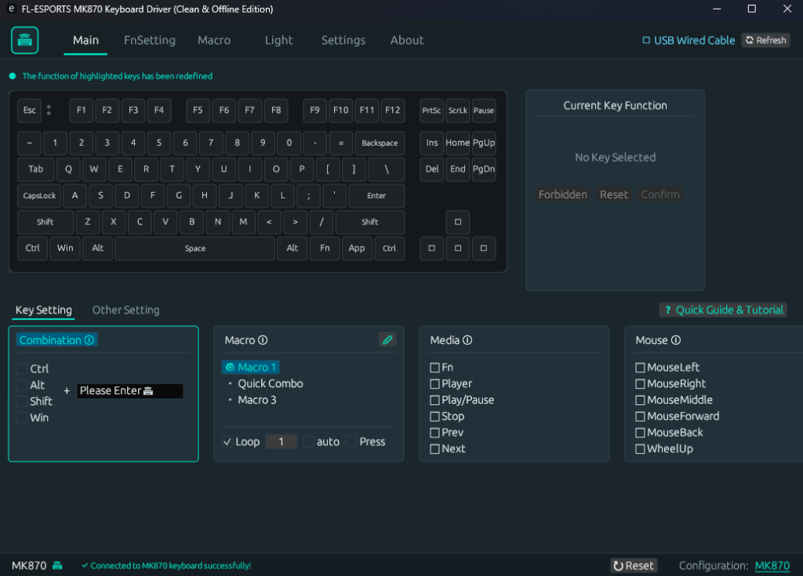
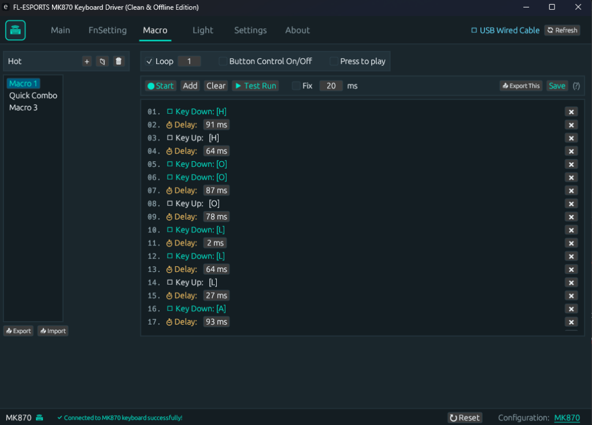
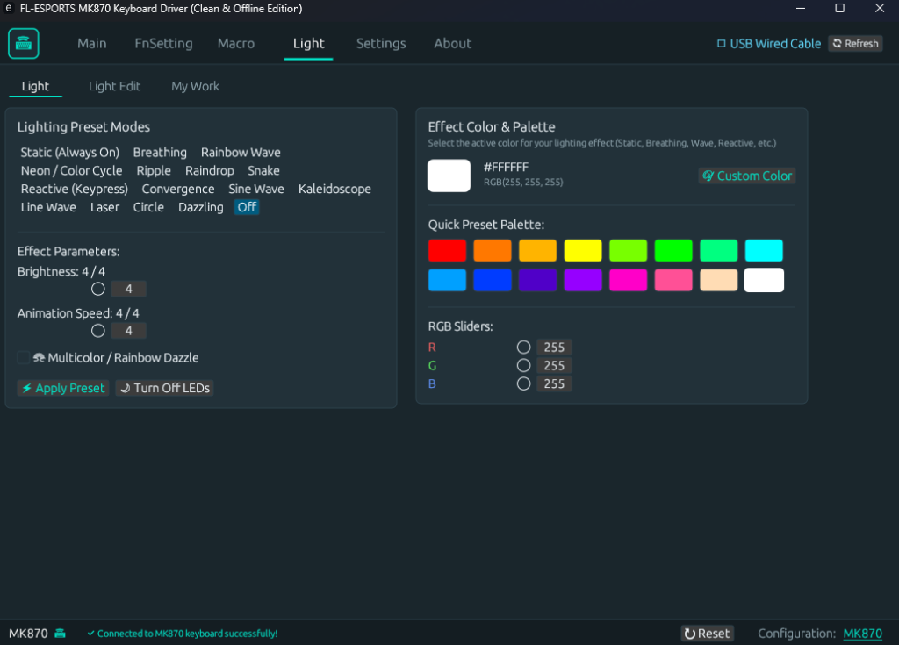
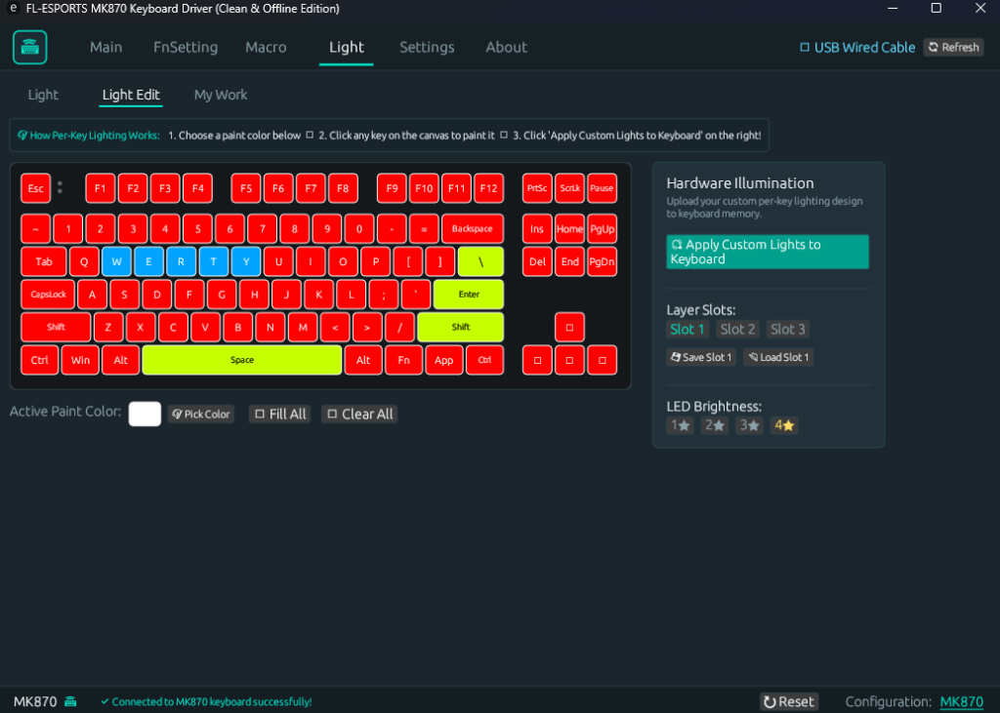

# ⌨️ debloatedfl-driver (MK870 Rust Driver)

[](https://www.rust-lang.org/)
[](https://www.microsoft.com/windows)
[](LICENSE)
[](#-why-debloatedfl-driver-the-clean-alternative)
[](https://github.com/Some1sm/debloatedfl-driver/releases)

A clean, high-performance, 100% offline, privacy-first driver and control suite for the **FL-ESPORTS MK870** (and compatible Royuan/YC500-based) mechanical keyboards, built natively in Rust.

---

## 🛡️ Why debloatedfl-driver? (The Clean Alternative)

The official manufacturer software (`FL_setup_2.0.18.exe`) is an Electron web application bundled with invasive telemetry and bloat:
* **Motherboard & CPU Fingerprinting**: Bundles `node-machine-id` to extract unique hardware GUIDs.
* **Telemetry & User Tracking**: Bundles `universal-analytics` to log user events to Google Analytics.
* **Outbound Sockets**: Keeps persistent network sockets open to Chinese cloud endpoints (`api.rongyuan.tech:3814`).
* **Resource Waste**: Spawns multiple Chromium processes consuming **200 MB to 400 MB of RAM** and over **250 MB of disk space**.

### The Rust Solution:
| Feature / Metric | Official Vendor Software | **debloatedfl-driver** |
| :--- | :---: | :---: |
| **Download / Executable Size** | ~80 MB installer | **~5.4 MB** (Single portable executable) |
| **Installed Disk Space** | ~250 MB | **0 MB** (No installation needed) |
| **Memory (RAM) Footprint** | 200 MB – 400 MB | **< 20 MB** (Native `egui` GUI) |
| **Startup Latency** | 5 – 10 seconds | **< 50 ms (Instant)** |
| **Network & Telemetry** | Active tracking & outbound sockets | **100% Offline (Zero internet calls)** |
| **Hardware Fingerprinting** | CPU & Motherboard GUID harvested | **None (Zero data collected)** |
| **CLI / Scripting Support** | ❌ None | **✔ Full dual-mode CLI + GUI** |
| **Macro Engine** | Clunky web-based recorder | **✔ Real-time Windows input engine** |
| **Macro Portability** | Locked in internal database | **✔ 1-click JSON Import & Export** |

---

## 📸 Screenshots

| **Key Mapping & Layer Assignment** | **Macro Studio & Timeline Editor** |
|:---:|:---:|
| [](screenshots/main_key_mapping.png) | [](screenshots/macro_studio.png) |

| **RGB Lighting Studio & Color Palette** | **Custom Per-Key Illumination (Light Edit)** |
|:---:|:---:|
| [](screenshots/rgb_lighting_presets.png) | [](screenshots/per_key_illumination.png) |

---

## 🚀 Key Features

### 🖥️ Native Desktop GUI
* **Main Layer Key Customization**:
  * Remap any of the 87 physical keys.
  * Assign Single Keys, Modifier Combinations (`Ctrl+Shift+Esc`, etc.), Mouse Clicks, Media/Volume shortcuts, or Macros.
* **Dedicated FN Layer Customization**:
  * Customize secondary FN key layers independently.
* **Macro Studio & Real-time Playback Engine**:
  * Record keyboard and mouse inputs with accurate millisecond timings.
  * Edit delays, insert actions, and choose playback modes:
    * **While Pressed**: Repeats smoothly as long as you hold the trigger key.
    * **Loop N Times**: Plays a set number of times per press.
    * **Toggle Loop**: Starts looping on press, stops on next press.
  * **Import & Export**: Backup and share your macro library via native Windows `.json` file dialogs.
* **RGB Lighting Studio & Color Palette**:
  * **16 Hardware Lighting Presets**: Static, Breathing, Neon, Rainbow Wave, Ripple, Raindrop, Snake, Reactive (Keypress), Convergence, Sine Wave, Kaleidoscope, Line Wave, Laser, Circle, and Dazzling.
  * **Quick Preset Color Palette**: 16 one-click colors (Red, Cyan, Lime, Gold, Purple, White, etc.).
  * **Interactive Color Picker & RGB Sliders**: Real-time slider and hex adjustment directly inside the Light tab.
  * Complete control over Brightness (5 levels), Animation Speed (5 levels), and Rainbow Dazzle mode.
* **Per-Key Illumination (Light Edit)**:
  * Interactive 87-key wireframe canvas to paint individual keys.
  * 3 Onboard Hardware Slots saved to keyboard EEPROM.
  * Direct HID upload (USB cable or 2.4G dongle) using 7-packet raw RGB streaming protocol.
* **Performance & Hardware Controls**:
  * **Polling Rate**: Toggle 125 Hz, 250 Hz, 500 Hz, or 1000 Hz (1 ms response).
  * **Debounce Filter**: Hardware switch debounce slider (1 ms to 60 ms).
  * **Wireless Sleep Timers**: Customize 2.4G and Bluetooth idle timeout delays.
  * **OLED Clock Synchronization**: One-click local time sync for display models.
  * **Factory Reset**: Revert hardware to factory defaults with safety prompt.
* **Dual-Mode Connectivity (2.4G Wireless & USB Wired)**:
  * **2.4G Wireless Configuration (relaying receivers)**: Receivers that support the vendor relay handshake get lighting, per-key colors, polling rate, debounce, and sleep settings over 2.4G, plus live battery and awake/asleep state.
  * **Keystroke-only receivers**: The original `05AC:024F` MK870 receiver forwards keystrokes but not configuration commands. The driver detects this and asks for the USB cable instead of showing made-up values.
  * **Settings persist across modes**: Lighting and other settings saved over the USB cable stay active after switching to 2.4G.
  * **Bluetooth**: Over Bluetooth the keyboard acknowledges configuration writes but does not apply them, and rejects feature reads, so configuration also requires the USB cable.
  * **Hot-Plug Auto-Detection**: Switch between the USB cable and the 2.4G dongle anytime — the driver re-detects the connection within 1.5 seconds.
* **Clean Windows GUI (No Blank CMD Window)**:
  * Compiled as a native Win32 subsystem application (`#windows_subsystem = "windows"`). Double-clicking the app launches purely the graphical interface with zero blank console windows.
  * Running from terminal with CLI arguments (`info`, `rgb`, etc.) dynamically re-attaches to your console session automatically.
* **Accessibility & UI Scaling**:
  * Settings menu with live UI scaling slider (80% to 200%) and quick presets (100%, 120%, 140%, 160%).
  * Font size booster (`+0pt`, `+2pt`, `+4pt`) for high-resolution (1440p / 4K) displays.
  * Configuration persisted locally in `%APPDATA%\fl-driver-rs\settings.json`.

---

## 💻 Command Line Interface (CLI)

`debloatedfl-driver` (`fl-driver-rs.exe`) is a dual-mode binary. Run it with no arguments to open the GUI, or use CLI subcommands in terminal/PowerShell scripts:

### Device Information & Battery
```powershell
.\fl-driver-rs.exe info
```

### RGB Lighting Control
```powershell
# Set static color by HEX or preset name
.\fl-driver-rs.exe rgb --mode static --color FF0055
.\fl-driver-rs.exe rgb --mode static --color cyan

# Full rainbow wave animation at maximum speed & brightness
.\fl-driver-rs.exe rgb --mode wave --rainbow --speed 5 --brightness 4

# Subtle breathing effect
.\fl-driver-rs.exe rgb --mode breath --color 00FF88 --speed 2

# Turn LEDs completely off
.\fl-driver-rs.exe rgb --mode off
```

### Adjust USB Polling Rate
```powershell
.\fl-driver-rs.exe rate 1000   # 1000 Hz (1 ms)
.\fl-driver-rs.exe rate 500    # 500 Hz (2 ms)
```

### Adjust Switch Debounce
```powershell
.\fl-driver-rs.exe debounce 4  # 4 ms
```

### Sync Keyboard Hardware Clock
```powershell
.\fl-driver-rs.exe clock
```

---

## 🔬 Protocol & Reverse Engineering Details

The driver interfaces directly with the keyboard via Windows SetupAPI and low-level HID Feature Reports:
* **Target VID/PID**:
  * Wired USB and 2.4G dongle both enumerate as `VID_05AC & PID_024F`, interface `MI_00` (Usage Page `0x01`, Usage `0x06`).
  * The dongle is told apart by its product string, `2.4G Wireless Device`.
* **Report Structure**:
  * Report ID: `0x00`
  * Frame Length: 65 bytes (`0x00` Report ID + 64-byte payload).
* **Command Codes**:
  * `0x07` (`FEA_CMD_SET_LEDPARAM`): Global lighting mode, speed, brightness, and color.
  * `0x87` (`FEA_CMD_GET_LEDPARAM`): Query active lighting status.
  * `0x04` (`FEA_CMD_SET_REPORT`): Set USB polling rate.
  * `0x11` (`FEA_CMD_SET_DEBOUNCE`): Set switch debounce delay.
  * `0x12` (`FEA_CMD_SET_SLEEPTIME`): Set 2.4G and Bluetooth sleep timeouts.
  * `0x0C` (`FEA_CMD_SET_USERPIC`): Upload 7 packets × 56 bytes of raw per-key RGB matrix data.
  * `0x28` (`FEA_CMD_SET_OLEDCLOCK`): Push Year/Month/Day/Hour/Min/Sec to onboard clock.
  * `0x02` (`FEA_CMD_SET_RESERT`): Hardware factory reset.
* **Checksum Types** (as computed by the vendor driver):
  * `Bit7`: `!(buf[0] + … + buf[6])` written to `buf[7]`. Used for queries and most settings.
  * `Bit8`: `!(buf[0] + … + buf[7])` written to `buf[8]`. Used for `SET_LEDPARAM`, whose color occupies bytes 5–7.
* **2.4G Dongle Relay** (reverse-engineered from the vendor's `iot_driver.exe`):
  * A relaying receiver answers these opcodes itself (sent without a checksum):
    * `0xFD`: probe. Relaying receivers reply `AA 55`; the driver only uses the relay when they do.
    * `0xFB`: status. Reply bytes are `[reply ready = 1, battery %, keyboard offline (0 = awake), write delivered = 1]`.
    * `0xFC`: fetch the keyboard's buffered reply; the next feature read returns it.
  * Write: poll `0xFB` until the last write was delivered, send the command, poll again until it is delivered.
  * Read: poll `0xFB` until a reply is ready, send `0xFC`, then read the 64-byte reply.
  * The original `05AC:024F` receiver (firmware dated 2022-12-07) does not implement this: it returns the same fixed 64-byte frame to every request and does not forward commands to the keyboard.

---

## 🛠️ Building from Source

### Prerequisites
* [Rust](https://rustup.rs/) (1.75 or later)
* Windows SDK (for standard MSVC link libraries)

### Build Steps
```powershell
# Clone the repository
git clone https://github.com/Some1sm/debloatedfl-driver.git
cd debloatedfl-driver/fl-driver-rs

# Build optimized release binary
cargo build --release
```
The compiled executable will be located at `target/release/fl-driver-rs.exe`.

---

## 📄 License

This project is licensed under the [MIT License](LICENSE).

---

## ⚠️ Disclaimer
*FL-ESPORTS is a trademark of its respective owner. This project is an independent open-source reverse-engineering effort and is neither affiliated with nor endorsed by FL-ESPORTS or Royuan.*
